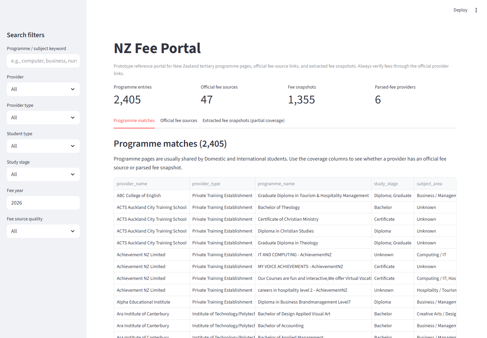

# NZ Fee Portal

Make New Zealand tertiary programme and fee-source information easier to find and assess through a shared reference catalogue.

## Why this project?

Programme and fee information is distributed across provider websites. Bringing records together helps discovery, but a combined table can still have uneven coverage, unclear classifications and historical prices. Before using it for comparison, a reader needs to know both where a record came from and what the dataset can support.

The objective of this prototype is to let a prospective student or analyst **find relevant programmes and provider sources in one catalogue, then inspect the data quality before further fee analysis**. A complete, current tuition-comparison service remains beyond this release.

## Approach

- **Search the saved catalogue:** pandas loads the snapshots into a Streamlit interface with separate programme, official-source and extracted-fee tabs. Provider, study-stage, student-type and year filters help narrow the available records; partial fee coverage remains visible.
- **Make the records queryable:** a separate loader builds a SQLite table for SQL exploration of the same programme records. The app itself continues to read CSV.
- **Expose quality and coverage:** a reproducible report counts missing values, classifications and providers. Original-name and transformation-note fields in the supplied snapshot help readers inspect its history.

The repository begins with existing processed CSV snapshots. It does not contain the extraction and cleaning pipeline that originally produced them.

## Results and evidence

| Output | What can be checked |
|---|---|
| Searchable catalogue | 2,405 programme records covering 66 providers; the local interface was run and captured below |
| SQL analysis input | The database loader successfully imported all 2,405 programme records |
| Quality finding | 541 records have `Unknown` as their subject area, despite passing ordinary missing-cell checks |
| Additional reference data | 47 fee-source entries covering 24 providers; 1,355 fee snapshots covering 6 providers |

The quality finding matters because **non-empty values are not necessarily usable classifications**. The difference in provider coverage also means programme coverage cannot be treated as fee coverage.



Evidence: [quality report](reports/data_quality_report.md), [input snapshots and scope](data/README.md), [database loader](scripts/build_database.py) and [tests](tests/). Ten automated tests passed in the 23 November 2026 review; they support the implementation checks, not the accuracy of every provider's information.

## What remains to be established

This release demonstrates catalogue search, SQL loading and quality reporting. It has not measured user search-time savings or verified a complete, current fee comparison. Future work would need the source collection pipeline, consistent fee/year definitions, broader fee coverage and task-based user evaluation. Always check current information with the original provider.

**Implementation:** Python · pandas · SQLite · Streamlit · pytest · GitHub Actions

## Run locally

From the repository root, using your Python environment:

```bash
python -m pip install -r requirements.txt
python -m streamlit run app/streamlit_app.py
```

Build the analysis database and regenerate the report:

```bash
python scripts/build_database.py
python scripts/data_quality_report.py --report-path reports/data_quality_report.md
python -m pytest -q
```

The database builder replaces the local `programme_index` table from the CSV. Keep any separate analysis tables or manual edits in another database.

## Repository guide

| Location | Responsibility |
|---|---|
| `app/` | Streamlit interface |
| `src/` | Reusable search and database helpers; public UI filters live in `app/` |
| `scripts/` | Database build and quality report commands |
| `examples/` | SQLite inspection and SQL practice |
| `data/processed/` | Versioned input snapshots |
| `reports/` | Inspectable data quality outputs |
| `tests/` | Search, schema and data checks |
| `.github/workflows/` | Automated checks and report generation |

See [data scope and provenance](data/README.md) and [implementation notes](docs/architecture.md).
