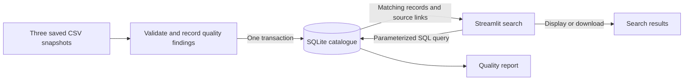

# NZ Fee Portal

Search New Zealand tertiary programmes and inspect the historical fee evidence for a specific programme, cohort and year. Each result includes a provider link and the recorded check date. Built with Python, SQLite, pandas and Streamlit.

[Open the live NZ Fee Portal](https://nz-fee-reference.streamlit.app/). If Streamlit says the app is asleep, choose **Yes, get this app back up!** and wait for the search page.

## Try a search

1. Choose **Lincoln University**, enter **agriculture**, select **Domestic** and enter **2026**.
2. Under **Find a programme**, inspect **Bachelor of Agriculture**. The saved source records **NZ$8,690 per 120 points**, checked **14 May 2026**. Open the fee-source link to confirm today's fee.
3. Change the fee year to **2100**. The programme remains searchable, the app explains the missing fee evidence, and its provider programme page remains available. Provider-wide sources appear separately when they satisfy the selected filters.

## How it works



The importer checks required fields, source URLs, date formats, amounts, provider identity and duplicates. A hard failure rejects the release and preserves the last working database. Reviewable anomalies stay visible with their source file and CSV line number. The web app reads one committed version for each search.

## Coverage and limits

| Saved input | Records | Providers |
|---|---:|---:|
| Programme pages | 2,405 | 66 |
| Fee reference links | 47 | 24 |
| Extracted fee records | 1,355 | 6 |

Across the bundled snapshots, **55 programme records** have matching fee evidence on the same provider ID and normalised full title. Different majors, fee bases or student groups can produce several matches. Provider coverage flags indicate which institutions have evidence. For dates, flagged extraction issues and input hashes, see the [quality report](reports/data_quality_report.md).

Inputs were checked in May 2026. The importer refreshes the application from supplied snapshots. Gathering new provider pages is a separate upstream step. Check the original source for current fees and use the displayed fee basis before comparing amounts.

## Run and refresh

From the repository root with Python 3.11:

```bash
python -m pip install -r requirements.txt
python -m streamlit run app/streamlit_app.py
```

On first launch the app imports the three bundled snapshots into `local_db/nz_fee_portal.sqlite`. An earlier programme-only database is upgraded on first launch. To refresh an existing database with an updated, compatible set of CSVs:

```bash
python scripts/build_database.py --data-dir data/processed
python scripts/data_quality_report.py
python -m pytest -q
```

Use `--db-path PATH` with the import and report commands for a separate database. Set `NZ_FEE_DB` to that path to use it in the web app. Re-run a search after importing. The application uses the committed database until the next explicit refresh. The importer replaces its own tables and preserves unrelated tables.

## Repository guide

| Location | Responsibility |
|---|---|
| [app/](app/) | Search interface, programme details and downloads |
| [src/](src/) | Import rules, SQLite schema and parameterized queries |
| [scripts/](scripts/) | Import and report commands |
| [data/](data/) | Saved inputs and provenance |
| [reports/](reports/) | One reproducible report from the bundled release |
| [tests/](tests/) | Refresh, rollback, query and interface checks |
